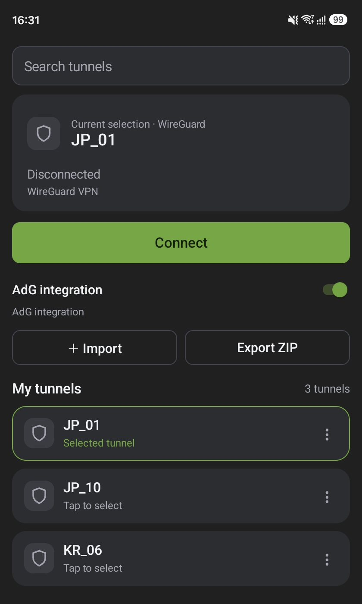
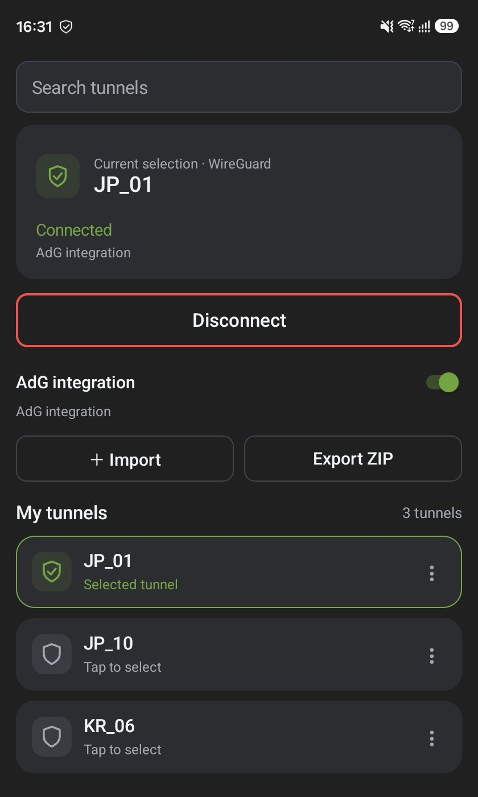
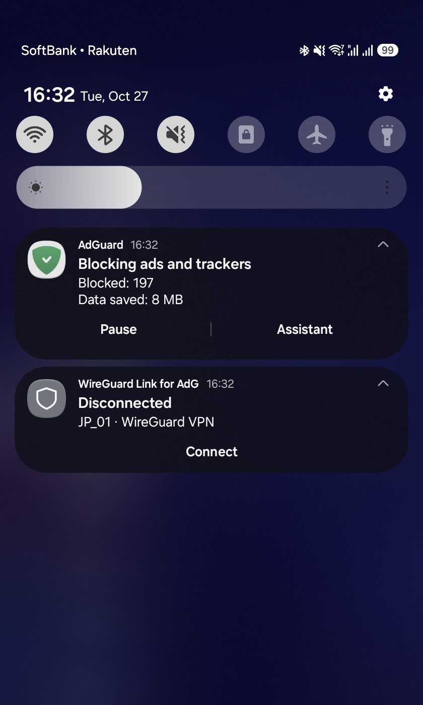
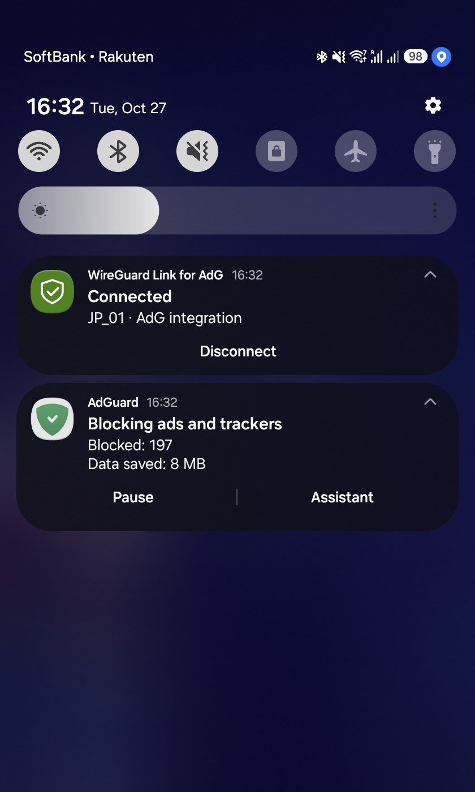

# WireGuard Link for AdG

**A WireGuard client built for seamless integration and coexistence with AdGuard.**

It also works as a standalone WireGuard VPN client without AdGuard. Integration is optional. No AdGuard VPN account or login is required.

[한국어](README.ko.md) · [Build from source](docs/BUILD.md) · [Integration](docs/INTEGRATION.md) · [Third-party notices](THIRD_PARTY_NOTICES.md)

Download the signed APK from [Releases](https://github.com/david419kr/wireguard-link-for-adg/releases).

## Screenshots

<table>
  <tr>
    <th>Disconnected</th>
    <th>Connected</th>
  </tr>
  <tr>
    <td align="center"></td>
    <td align="center"></td>
  </tr>
  <tr>
    <td align="center"></td>
    <td align="center"></td>
  </tr>
</table>

App and notification views alongside AdGuard. Click an image to view it at full size.

## Install

**If the official AdGuard VPN app is installed, uninstall it before installing this app. The two apps cannot be installed together.**

The package name is `com.adguard.vpn`, which is required by the integration protocol. Open the app, import a tunnel, select it, and tap Connect. Android may ask for VPN and notification permission.

## Features

- Standalone Android VPN or authenticated local SOCKS integration with the AdGuard ad blocker.
- Import WireGuard `.conf` files, exported ZIP archives, camera QR codes, and QR images; export tunnels as a WireGuard-compatible ZIP.
- Rename tunnels; expand Advanced to edit the raw configuration. Invalid edits are rejected before saving.
- One selected tunnel and one Connect/Disconnect control. Selection is remembered; selecting a different tunnel while connected switches to it.
- Quick Settings tile with the selected tunnel name, tap to toggle, and long press to open the app.
- Android app shortcut compatible with the original toggle identifier used by Samsung Modes and Routines.
- Notification Connect/Disconnect actions, connection-aware shield icons, and a neutral gray fallback for systems such as ColorOS that force the application icon.
- Korean UI for Korean; English fallback for other languages.

## Use with AdGuard

Leave **AdG integration** enabled to coordinate with the installed AdGuard ad blocker. When its protection is active, AdGuard owns the Android VPN interface and this app supplies the authenticated local proxy. When integration is disabled, this app runs its own VPN. Android VPN permission may be required when switching to standalone mode.

AdGuard is optional. For standalone use, disable AdG integration. Integration protocol version 3 is supported; device interoperability has been checked with AdGuard 4.15.0 on a Samsung SM-F968N. UI and network transitions are not certified across every device or OS build. See [testing and limitations](docs/TESTING.md).

## Privacy

Tunnel configurations are encrypted on the device with Android Keystore. There are no advertising, account, analytics, or crash-reporting SDKs. Network connections are made for the configured VPN/DNS service and normal VPN traffic. AdG coordination uses local Android IPC.

## Source and licensing

**No resources from AdGuard VPN or AdGuard are included.** This independent project distributes no original app code, images, resources, modified APKs or proprietary VPN engine. Fixed package/component names are interoperability identifiers. The UI artwork is project-authored.

Project-authored code is licensed under [Apache-2.0](LICENSE). Dependencies retain their own licenses; see [NOTICE](NOTICE), [THIRD_PARTY_NOTICES.md](THIRD_PARTY_NOTICES.md), and [third-party](third-party).

This is an unofficial project and is not affiliated with or endorsed by AdGuard or WireGuard. Their names identify interoperability and protocol support.
